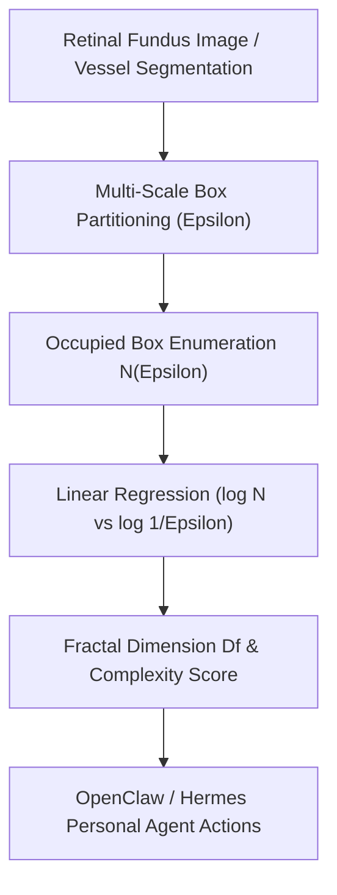

# Retinal Vascular Box-Counting Fractal Dimension (Df) Skill

[](LICENSE)
[](https://www.python.org/)
[](requirements.txt)
[](mcp_server.py)
[](SKILL.md)

Zero-dependency sovereign personal agent skill for non-invasive evaluation of retinal microvascular box-counting fractal dimension (Df), arborization complexity, and capillary rarefaction.



## Features
- **Deterministic Math**: Pure Python standard library implementation with zero external dependencies.
- **Mathematical Fractal Geometry**: Implements rigorous logarithmic box-counting and Pearson correlation validation.
- **Microvascular Aging Stratification**: Non-invasive detection of capillary rarefaction and cerebral small vessel health.
- **Model Context Protocol (MCP)**: Native JSON-RPC tool integration for LLMs and autonomous agents.

## Quickstart

```python
from client import RetinalVesselFractalDimensionClient

client = RetinalVesselFractalDimensionClient()
result = client.evaluate_fractal_dimension(
    box_sizes=[4.0, 8.0, 16.0, 32.0, 64.0, 128.0],
    box_counts=[1745, 640, 235, 86, 31, 11]
)
print("Fractal Dimension Df:", result["fractal_dimension_df"])
print("Classification:", result["classification"])
```

## License
Apache-2.0
